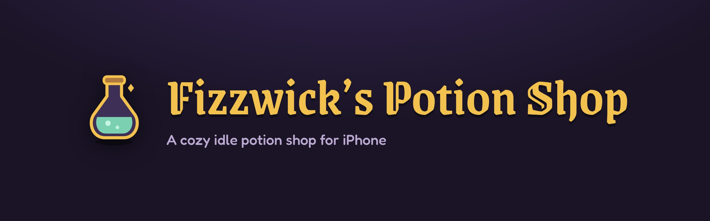
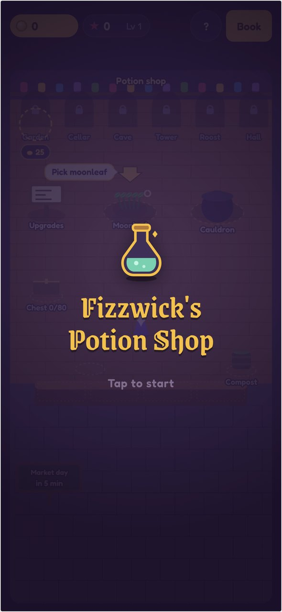
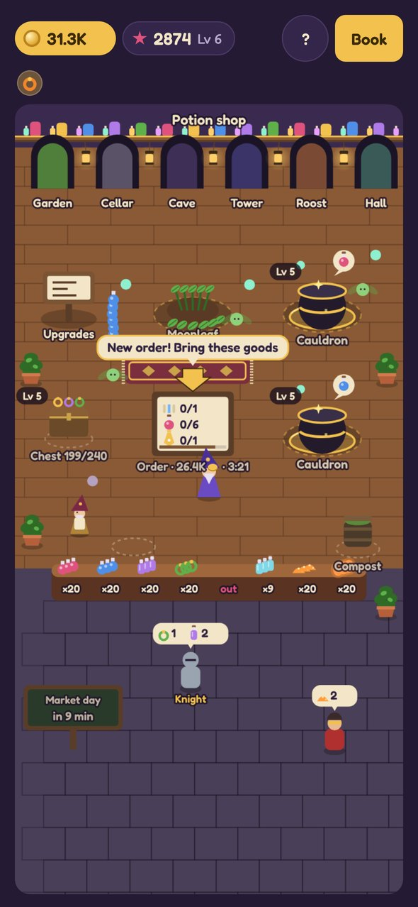
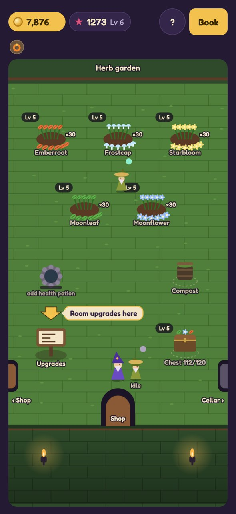
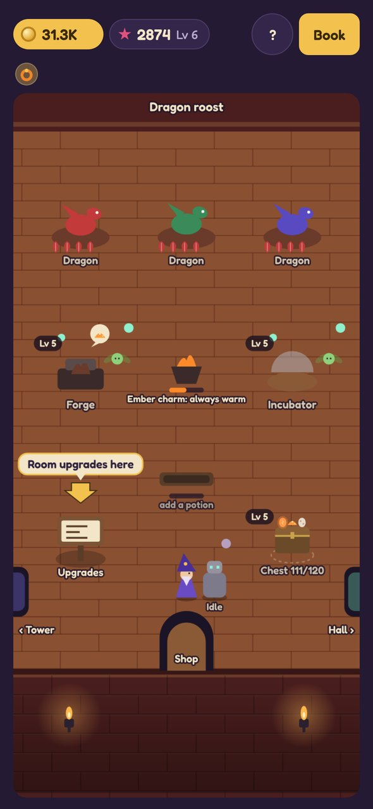

  

  <b>A cozy idle potion shop for iPhone.</b> 
  Grow herbs, brew potions, hire helpers, and build your little shop into a magical empire. 
  <i>Coming soon to the App Store · free to try · one-time unlock · no ads</i>

  &nbsp;
  &nbsp;
  &nbsp;
  

## Features

| | |
|---|---|
| 🧪 **Brew and sell** | Plant herbs, fire up cauldrons and keep the counter stocked for a steady line of customers. |
| 🧙 **Hire helpers** | Workers, porters and a shopkeep run the place while you plan the next room. |
| 🏰 **Grow your shop** | Open a garden, cellar, tower, dragon roost and more, each with new potions to make. |
| 🌑 **Two worlds** | Step through the Void Gate into a darker world, earn shadowmarks, and ascend. |

## Help

- **Support & FAQ:** [skylerstearns.github.io/fizzwicks](https://skylerstearns.github.io/fizzwicks/#support)
- **Privacy policy:** [skylerstearns.github.io/fizzwicks/privacy.html](https://skylerstearns.github.io/fizzwicks/privacy.html)
- **Email:** [stearnsappstudios@gmail.com](mailto:stearnsappstudios@gmail.com)

---

© 2026 Stearns App Studios. This repository hosts the game's public website only. Fonts: Fredoka and Grenze Gotisch (SIL Open Font License).
